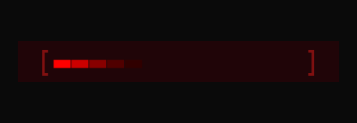

# Busy Status

## Preview



The GIF shows the real plugin renderer at its actual 90 ms/frame speed, using a
running-session fixture. A [static screenshot](../../docs/images/busy-status.png)
is also available. Terminal font rendering may vary.

## Behavior

A five-character red running light sweeps continuously back and forth across a
dark, twelve-cell track with no text label. All five characters are centered
rectangles (`▬`): a saturated bright-red head followed by four progressively darker trail cells.
Exact vertical alignment depends on the terminal font.
Dark-red square brackets (`[` and `]`, `#801010`) fence the track. The twelve-cell
running light and existing outer padding are unchanged; the whole widget occupies
sixteen columns, exactly two more than the unbracketed version.
The bright head travels one cell per frame all the way to each edge. The four
darker shades mark its previous four positions, rather than flipping the whole
shape when reversing. After each turnaround, older trail cells briefly overlap
more recent positions, so three or four blocks are visible instead of five; newer shades
always stay on top. This avoids an edge jump while keeping the light inside
the track throughout the sweep.
It lives in the current session's prompt status row, with a fixed width so the
animation never shifts nearby text. The entire indicator disappears when the
session is idle, including after completion, cancellation, or failure. Other
sessions do not affect it.

Uses OpenCode V2's reactive session status, so loading the plugin during a running
turn works without waiting for another start event. The track stays visible throughout
the turn, including tool calls and retries, for as long as OpenCode reports the
session as running. It does not infer activity from individual text/tool events.

## Install

Merge this entry into your global `~/.config/opencode/cli.json` (or the equivalent
under `$XDG_CONFIG_HOME`), replacing the placeholder with your checkout path:

```json
{
  "plugins": ["/path/to/opencode-plugins/packages/busy-status"]
}
```

Configuration reloads automatically; `/reload` forces a refresh. No server
plugin or credentials are required. Tested against the OpenCode **2.2.7** API.

The scanner intentionally animates independently of the global `animations`
setting. Its fully saturated bright-red head (`#ff0000`) fades through `#cc0000`,
`#880000`, `#500000`, and a faint final tail (`#300000`) on a dark red track (`#200508`). The light reverses
at each end without blank frames or pauses. It advances one cell every 90ms. Its animation
timer exists only while visible and is cleaned up on idle, session switching,
plugin disable/reload, or UI disposal. Existing status contributions are preserved.

## Standard status bar

The standard session status bar is **hidden by default**. Run `/statusbar` to
show it, then run `/statusbar` again to hide it. The command palette offers
**Show standard status bar** or **Hide standard status bar**, matching the
current state. The choice is stored durably and survives plugin reloads and
client restarts; it also synchronizes across running clients.

Hiding the bar replaces only the session's built-in prompt footer. The scanner
and Activity Status live outside that boundary permanently, so they remain
visible without remounting when the bar is toggled. Their animation, hover, and
goal state are independent of the standard bar's visibility and plugin order.
Plugins placed before/after `prompt.footer` remain
visible; prepend/append contributions and plugins inside `prompt.footer.status`
or `prompt.footer.file` are hidden with the built-in row.
The home screen is unchanged.

This replaces the temporary `/footertrial` prototype. No changes to `cli.json`
are needed; the preference belongs to Busy Status's plugin storage.

## Verify

```sh
npm test --workspace=opencode-busy-status
npm run test:busy-status
```

The renderer test requires Bun. For a live smoke test, send a prompt with a tool
call, verify the five-block light sweeps both ways while working and disappears after the final
response, then repeat with cancellation and a session switch. Reload during a
running turn and confirm there is only one indicator.
