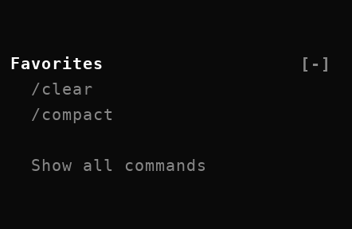

# Favorites

## Preview



Captured from the real plugin renderer with sample session data. Terminal font rendering may vary.

A TUI-only plugin for **OpenCode V2**, targeting SDK **2.2.7**.

Adds a **Favorites** heading to the right-hand session sidebar with these rows:

- `/clear`
- `/compact`
- **Show all commands**, separated from `/compact` by one empty line.

The header has an ASCII **[-]** control, gray by default and bright white when any
part of the header is hovered, with one blank column at the right edge. Left-click
anywhere on the header—the title, empty space, or control—to collapse all rows and
spacing, leaving only the header with **[+]**; click the header again to expand. Right-clicks and drags are
ignored. The section starts expanded, retains its state while switching sessions,
and toggles independently of Skills and Links without changing the prompt.

Left-click **Show all commands** to open OpenCode's native command palette, the
same action as **Ctrl+P** (`command.palette.show`). This preserves the unfinished
prompt and attachments; it does not submit anything.

Left-click either slash-command row to focus the prompt and invoke the registered slash action,
just like selecting it in autocomplete—no second click or Enter needed. Favorites
resolves names and aliases from OpenCode's reachable command registry rather than
submitting literal slash text as a chat message or hard-coding command IDs.
These are OpenCode's built-in commands, not custom server commands. `/clear`
starts a new session; `/compact` compacts the current session.
**Any unfinished prompt and attachments are cleared before running the action.**
If an action accepts arguments, it is placed in the prompt for editing instead of
being run immediately, matching autocomplete. Unavailable or disabled commands
show a warning without clearing the draft.
Right-clicks and drags do not run commands.

## Load

Install the repository dependencies, then add this TUI-only package to your
global `~/.config/opencode/cli.json` (preserve your other settings and plugins):

```json
{
  "plugins": ["/path/to/opencode-plugins/packages/favorites"]
}
```

Configuration reloads automatically; `/reload` forces a refresh. The session
sidebar must be visible and the terminal wide enough to show it.

## Verify

```sh
npm run test --workspace=opencode-favorites
npm run test:render --workspace=opencode-favorites
```

The renderer test requires Bun. It tests actual mouse clicks and editor changes
with mocked host command discovery and dispatch; manually verify the built-in slash-command
effects in OpenCode before release.
