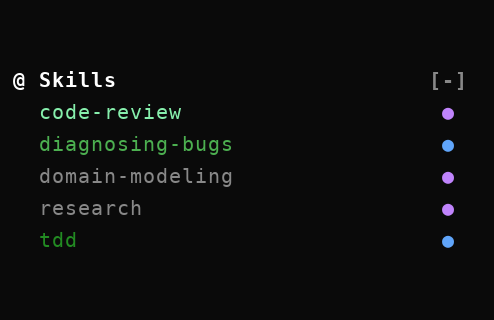

# Sidebar info

## Preview



Captured from the real plugin renderer with sample skills and usage history. Terminal font rendering may vary.

OpenCode V2 TUI plugin that lists available skills in the right sidebar in one
alphabetical list (case-insensitive display names, with ID tie-breaking), without
grouping or a divider. Skill names indicate how many times they were used within
the previous seven days:

- **No uses**: the theme's existing muted gray.
- **One use**: dark green (`#228B22`).
- **Two uses**: medium green (`#4CAF50`).
- **Three uses**: light green (`#86EFAC`).

Usage is a user-level plugin setting stored with OpenCode's durable TUI storage
under `skill-usage`, as a `lastClicked` map of skill IDs to their three latest Unix
timestamps in milliseconds, newest first. A use means a successful left-click
insertion into the prompt, not submission or model execution. Each click adds a
timestamp, evicting the oldest when there are more than three. Legacy single
timestamps count as one use and become arrays on the next click. History is
shared across sessions and survives plugin reloads and OpenCode restarts;
OpenCode synchronizes it across running TUI instances. Colors update on clicks
and once per minute as uses age out of the rolling seven-day window. Timestamps
exactly seven days old or older do not count, but remain in the stored history
until displaced by newer uses. No manual configuration is required.
The heading is `@ Skills` by default. Skill names are indented two columns
and shown without a prefix, colored by weekly usage. Each row has a right-aligned
colored dot (`●`) for repo and built-in origins only; global/user and unclassified
skills have no dot. Two blank columns after the dot separate it from the
scrollbar. The indicator column stays reserved for skills without dots.
Long names wrap in the space before the dot
without pushing it off the edge. The hover card keeps full source labels.
The dot and hover card's location value use the same source colors:

- **Global**: the theme's original muted text color (gray).
- **Built-in**: the theme's accent color.
- **Repo / workspace**: the theme's info text color (typically blue).
- **Other**: muted text for unclassified sources.

Colors follow the active theme, including light/dark mode. The hover card's
`Location:` label stays muted gray.
Hovering highlights the skill name immediately in the heading's bright text
color; leaving the row restores its usage color. Hidden skill names are an
exception: they always use dark blue (`#243B6B`), even on hover or after recent
uses. The dot keeps its source color.
Hover over a skill for 250 ms to show a card with its name prefixed by `@`, source
scope, exact active skill path, and description. The card disappears shortly after the pointer leaves the skill and
card, on a skill click/scroll, terminal blur, resize, or session/location changes.
Move onto the card to scroll long descriptions. Only the description scrolls;
the title, location, active path, and blank separator stay fixed.
Mouse movement reporting must be enabled in the terminal.
Left-click a skill to select its **native OpenCode autocomplete entry** at the
prompt cursor, preserving existing input and attachments and returning focus to
the prompt. This attaches the skill to the draft using the host's internal skill
mechanism, rather than merely inserting text that looks like a mention. It uses
`prompt.autocomplete.complete` (the Tab action), never Return, prompt submission,
or queueing. Add any additional instructions after the mention, then submit when
ready; selecting a skill does not execute it or load it into the conversation yet.
The host supplies a trailing space unless one is already present. A separating
space is inserted before the mention when needed. The invocable skill ID is used
even when the display name differs. Right-clicks and drags do not select skills.

If native completion is unavailable or the skill is already selected, a warning
is shown without recording a use; the plugin removes its uncompleted insertion
without resetting the draft or existing attachments. Concurrent user edits are
left alone. A named reference shadowing the same ID, an active text selection,
shell mode, or an ID containing whitespace, `@`, or `#` also produces a warning
instead of attaching the wrong reference or leaving a plain-text fallback. For
these cases, use OpenCode's built-in `/skills` selector.
Sources are classified from registry paths: Global for standard home skill
directories, Repo for project-local paths (including ancestor project skill
directories), Built-in for `skill://` paths, and Other for unclassified sources.
Home-level `~/.opencode/skills` is labeled Global, even though OpenCode discovers
it as an ancestor `.opencode` source. The labels describe storage scope, not
precedence tiers.
Uses OpenCode's reactive skill registry for the current session's location,
including global, project, and built-in skills. It already resolves duplicate
IDs according to server precedence. The row's
indicator, hover scope/path/description, and copy source all use that selected
definition; the existence of a different same-ID copy does not change them.
Live registry updates switch them together, including when a repo override is
removed and OpenCode falls back to a global or built-in definition.
Visibility is a user preference;
the plugin does not read skill files or scan the filesystem.
It appends to `sidebar.content` without replacing any built-in sections.
The host controls built-in ordering: this places the section below built-in
sidebar content, not necessarily immediately after Context.

## Hiding individual skills

The toggle just left of the collapse/expand control shows the current view:
**[mine]** for only non-hidden skills and **[all]** for every skill.
It is gray by default and bright white on hover. To temporarily reveal hidden
skills, left-click **[mine]**; the label becomes **[all]**. Click **[all]** to
return to only non-hidden skills and the **[mine]** label. Revealing all also expands a
collapsed section. This temporary view starts off in a new plugin instance and
retains its state across session switches and registry updates; it never changes
your saved hiding preferences, usage history, or prompt. Right-clicks and drags
are ignored.

To collapse the entire section, left-click its header outside **[all]**/**[mine]**—the title,
empty space, or ASCII **[-]** control. The control is gray by default and bright
white when the header outside **[all]**/**[mine]** is hovered, with one blank column at the right
edge. Only the header remains, with **[+]**; click the header again to expand.
This also dismisses hover cards and hides loading/empty
messages. The section starts expanded and retains its state across session
switches and live registry updates; Favorites and Links are unaffected.
Right-clicks and drags are ignored. Collapsing does not change skill visibility
metadata, usage history, or the prompt.

To hide a skill, **right-click its sidebar row** (name or source indicator) to
open a small context menu beside the pointer, then left-click **hide**. The action
is gray normally and bright in the theme's main text color (white in the default
dark theme) while hovered. The hover card is informational and contains no
hide action. Right-clicking does not select the skill or record usage; dragging
does not open the menu or execute its action.

The menu stays open when the pointer leaves it. Press **Escape** or click outside
to dismiss it without changing the draft; the outside click is consumed rather
than activating the element behind the menu. Opening the menu dismisses hover
details. It also closes on terminal blur, resize, collapse, session/location
changes, or registry updates. Placement is clamped to the terminal boundaries.
Your terminal must forward right-click events to OpenCode.

A successful save immediately removes the row (unless **[all]** is enabled) and
dismisses the context menu.
If saving fails, the skill remains visible and a warning is shown. Hiding does
not select the skill, modify the draft, submit a prompt, or delete usage history.

Hidden skills are saved in OpenCode's user-level durable TUI plugin storage
under `skill-visibility`, as a `hiddenIDs` map of invocable skill IDs to `true`.
Preferences persist across sessions, projects, plugin reloads, and OpenCode
restarts, and synchronize across TUI instances. The same ID stays hidden even
if its name or path changes, or it temporarily disappears from the registry.
Global, repo, and built-in skills can all be hidden. Other users keep their own
independent preferences. In the all-skills view, a hidden skill's context menu
offers **unhide** instead of **hide**. Left-click it to clear the saved hidden
flag; the skill returns to normal usage/hover colors and remains visible in the
mine view. A failed save leaves the flag unchanged and shows a warning. The
action has the same hover styling, right-click/drag guards, and menu dismissal
behavior as **hide**.

This is a sidebar-only preference: hidden skills remain available to the agent,
explicit mentions, and OpenCode's built-in selectors. The old frontmatter
`metadata.hide-in-opencode` field is no longer used or migrated; each user
chooses which skills to hide using the context menu.

## Copying a global skill to the repo

Globally stored skills have a second context-menu action: **copy to repo**.
Right-click the skill and left-click that action to copy it into:

```text
<current session working directory>/.agents/skills/<skill-id>/
```

The action is gray normally and bright on hover. Repo, built-in, and other
non-global skills do not show it. Directory-based skills copy their complete
directory, including scripts, references, binary assets, hidden files, and empty
folders. Executable permissions are preserved and source symlinks are
dereferenced, making the copy independent of the original. A flat Markdown
skill is copied as `<skill-id>/SKILL.md`, without its neighboring skills.
The original global skill is never moved, edited, or hidden.

Copying runs through the **connected server's shell API**, using Node.js on that
server, not the TUI machine's filesystem. The server must have `node` on its PATH
and a POSIX-compatible shell. It does not use a model or submit/edit the prompt.
Paths and IDs are shell-quoted. The destination is reserved with an exclusive
directory creation: an existing skill folder, file, or symlink is never merged
or overwritten, including when two copies run concurrently. Symlinked `.agents`
or `skills` destination folders are refused to avoid writes outside the repo.
If copying fails after destination creation, a warning identifies the possible
partial copy; the plugin does not recursively delete it.

A success toast is shown **only after OpenCode selects the repo definition**.
To make the copied skill supersede its same-ID global definition, the action
registers `./.agents/skills` as the last explicit source in the working directory's
`.opencode/opencode.json(c)`. If neither file exists, it creates
`.opencode/opencode.jsonc` with the schema and that source. Existing settings and
JSONC comments are preserved; concurrently edited config is not overwritten.
The plugin sends only edit offsets/new source text and a content digest to the
server shell, never existing config contents that could contain credentials.

Config saves trigger server rediscovery. The action waits for the server's
skill registry to select `.agents/skills/<skill-id>/SKILL.md`, then refreshes the
sidebar so its source indicator becomes Repo. It does not fake a local label or
change global skill files. If activation fails, it reports a warning instead of
claiming success. It avoids a server-wide reload, which would interrupt unrelated
forms and permissions. Copying does not change visibility preferences or usage
history.

## Installation and configuration

Prepared against OpenCode 2.2.7. See the [repository installation
guide](../../README.md) for dependencies and replacing an existing local copy.
Merge this TUI-only plugin's entry into `~/.config/opencode/cli.json` (or its XDG
equivalent), replacing the example path with your checkout's absolute path:

```json
{
  "plugins": [
    {
      "package": "/path/to/opencode-plugins/packages/sidebar-info",
      "options": { "title": "Skills" }
    }
  ]
}
```

The `title` option customizes the heading label; `@ ` is always prepended.
The section is visible when the session sidebar is visible. With
`session.sidebar` set to `auto`, the terminal must be wide enough to show it.
Valid configuration changes reload automatically; `/reload` forces a refresh.

The plugin returns the slot's unregister function so reloads clean up the old
section. It does not modify Context Inspector or session data. The original
plugin ID `local.sidebar-info` is retained; do not load both copies at once.

Run checks with `npm test` in this directory.

For the optional rendered hover regression, install devDependencies and run
`npm run test:hover` with Bun. It sends simulated terminal mouse movements and
checks that the card is on-screen, stays open over its contents, and dismisses on
leave. The portal wrapper is absolutely positioned and zero-sized so it neither
flows below the application nor intercepts the skill row's mouse events.
The same test checks native-completion dispatch, mention marks, additional typing,
attachment preservation, no auto-submission, and failed/duplicate selection
rollback against mocked host completion. It also checks context-menu placement,
hover colors, fixed location/separator during description scrolling,
right-click/drag guards, Escape/outside-click dismissal, failed saves, retained usage history, and
durable visibility across session changes and new plugin instances. Verify a
skill click and the hide action in the live TUI after `/reload` to check the
installed host integration. The renderer test also covers global-only copy
actions, hover colors, server/location targeting, refresh, and copy failures.
The Node tests exercise the exact server-side copy command against temporary
filesystem fixtures, including assets, permissions, quoting, symlinks,
existing destinations, and concurrent copies.
They also cover explicit source registration, real registry selection, preserved
JSONC comments/BOMs, and concurrent config edits. For an optional regression
against a running local OpenCode service, run `npm run test:copy:live` (optionally
with `-- <global-skill-id>`). It copies a global skill into an owned temporary Git
repo and asserts that the real server selects the local file without a manual
reload, then removes only that fixture.
